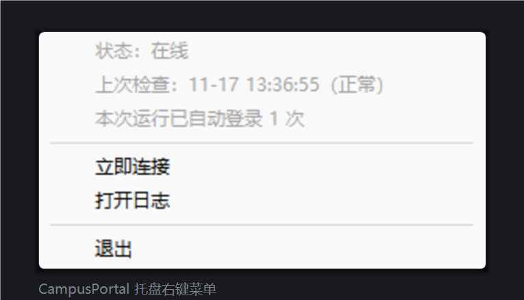
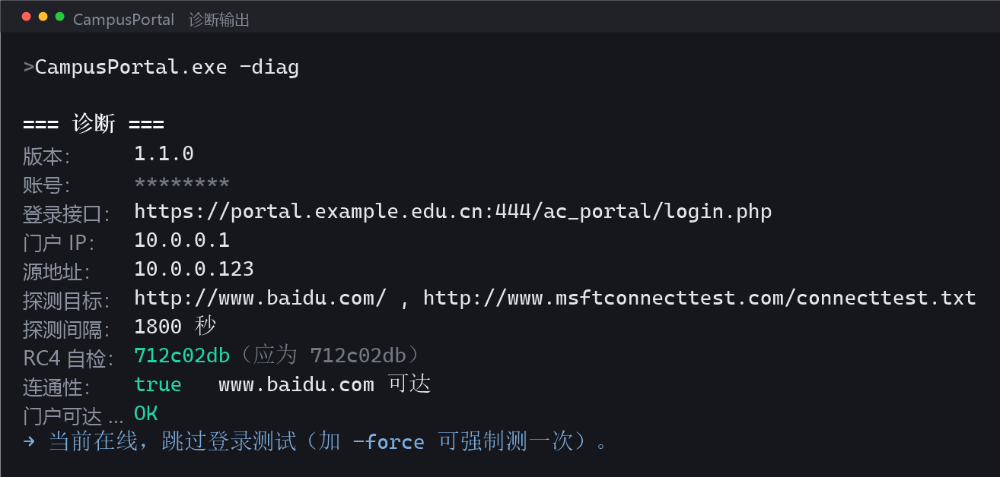

<div align="center">

# CampusPortal

**校园网自动登录守护程序**

掉线自动重连 · 托盘状态 · 无浏览器 · 常驻内存 5 MB · 单文件零依赖

[](https://go.dev)
[]()
[]()
[]()
[]()
[]()

</div>

---

## 这是什么

> **直接下载**：去 [Releases](https://github.com/Zhengyici/CampusPortal/releases/latest) 拿 `CampusPortal.exe`（6 MB，免安装，不用装 Go）。

很多学校的校园网（H3C `ac_portal`、锐捷 ePortal、深澜 srun 等）长时间连着会自己掉线，
掉线之后必须打开浏览器、进认证页面、手动敲一遍学号和密码才能恢复上网。

这个程序把这件事自动化了：常驻后台，定时探测，发现掉线就用已保存的账号密码
自动重新登录。**不开浏览器、不弹窗、不打扰你。**

托盘里有个小图标随时告诉你它还在不在线：


右键点它还能看上次检查时间、点「立即连接」当场登录一次，详见下面的[右键菜单](#右键菜单)。

> 实测：手动点「立即连接」后 **3 秒**完成登录并恢复联网；
> 自动守护按 `interval_sec`（默认 1800 秒）轮询，掉线最迟一个轮询周期内被发现。

```
2026-11-17 13:36:52 [INFO] 收到「立即连接」，强制登录一次
2026-11-17 13:36:55 [INFO] 手动登录成功（logon success），网络已恢复
```

## 特性

- **零依赖**：单个 6 MB 的 `.exe`，只用 Go 标准库，不需要装 Python / Node / 浏览器
- **省资源**：常驻内存约 5 MB（私有工作集 3 MB），CPU 几乎不动（跑 3 小时累计 1.7 s）
- **静默**：编译为 `windowsgui` 子系统，无控制台窗口、无弹窗
- **托盘状态**：任务栏托盘一个 Wi-Fi 图标，绿色=在线、红色=离线、紫色=正在登录；
  右键可看「上次检查时间」、点「立即连接」强制登录一次、打开日志、退出
- **抗劫持**：不只看 HTTP 200，还校验页面内容，识破网关返回的假 200 认证页
- **抗干扰**：可绕开 Clash / mihomo 的 TUN + fake-ip，直连门户真实 IP
- **密码安全**：用 Windows DPAPI 加密存储，换机器 / 换用户解不开
- **指数退避**：登录失败不会狂刷，最多 5 分钟重试一次，避免账号被锁
- **二次确认**：探测失败后等 3 秒复检一次，滤掉瞬时抖动误判

---

## 让 AI 帮你装（推荐）

不想自己敲命令？把下面整段复制给任意一个能读写本地文件和执行命令的 AI 助手，
**把第一行的链接换成这个仓库的地址**，然后它就会自己把剩下的活干完：

````text
请帮我安装并配置这个开机自启的校园网自动登录工具：
<把 GitHub 项目链接粘贴到这里，例如 https://github.com/Zhengyici/CampusPortal>

要求：
1. 先读仓库里的 README.md，按里面的「快速开始」操作。
2. 装到非系统盘（不要放 C:\ 下的用户目录，D:\ 或 E:\ 都行），
   如果这台机器没有非系统盘，就装在 D:\CampusPortal 或当前用户目录下并告诉我原因。
3. 优先用 Release 里编译好的 exe；没有再装 Go 自己编译
   （go build -trimpath -ldflags "-s -w -H windowsgui" -o CampusPortal.exe .）。
4. 我学校的认证页面地址是：<在这里填你平时登录校园网时浏览器地址栏的网址>，
   如果我不知道，你要先教我怎么在浏览器 F12 的 Network 面板里找到那个 login 接口。
5. 运行 CampusPortal.exe -setup，问我要学号和密码（密码我自己输，不要打印到屏幕或日志里），
   然后确认它打印「成功 ✓」。
6. 双击 3-设为开机自启.cmd 或等价的命令设置开机自启，
   然后用 reg query "HKCU\Software\Microsoft\Windows\CurrentVersion\Run" /v CampusPortal
   确认注册表项存在且指向刚装好的那个 exe。
7. 最后运行 CampusPortal.exe -diag，把诊断结果贴给我；
   再手动去认证页面点一次「注销」制造掉线，然后右键托盘图标点「立即连接」，
   看 portal.log 里有没有出现「手动登录成功」，确认守护真的生效。
8. 全程别把学号和密码写进任何会提交到 git 的文件。
````

---

## 快速开始

### 1. 编译（或直接用 Release 里的 exe）

```bash
git clone https://github.com/Zhengyici/CampusPortal.git
cd CampusPortal
go build -trimpath -ldflags "-s -w -H windowsgui" -o CampusPortal.exe .
```

只需 Go 1.21+，无第三方依赖。

### 2. 设置账号密码

双击 `1-设置账号密码.cmd`，依次输入：

1. 认证接口地址（首次必填，见下方「怎么找认证接口」）
2. 学号
3. 密码（输入时不回显）

脚本会立即测试一次登录，看到「成功 ✓」就说明配好了。

或者命令行：

```powershell
.\CampusPortal.exe -setup -portal https://认证服务器/ac_portal/login.php -u 你的学号
```

### 3. 设为开机自启

双击 `3-设为开机自启.cmd`。

### 4. 完成

以后开机自动在后台运行，掉线自动重连。查看状态双击 `2-检查状态.cmd`。

### 怎么找认证接口

两种办法：

- **看浏览器地址栏**。掉线后随便打开一个 http 网站，会被跳到认证页，
  地址栏里那个地址通常就是。把路径里的 `pc.html` / `index.html`
  换成 `login.php`（H3C）或对应接口名即可。
- **看 F12 的 Network**。掉线状态下打开认证页，按 F12 → Network → 勾选 Preserve log，
  输入账号密码点登录，找到那条 `POST` 请求，它的 URL 就是认证接口，
  Form Data 里能看到参数名和加密后的密码格式。

不同厂商的参数名不一样，见下方「支持的认证系统」。

---

## 使用

### 托盘图标

程序启动后会在任务栏托盘放一个 Wi-Fi 图标，颜色就是它的状态：

| 图标 | 颜色 | 含义 |
|:--:|:--|:--|
|  | 绿色 | 在线，网络正常 |
|  | 红色 | 离线，探测失败或登录失败 |
|  | 紫色 | 正在登录 |

Windows 11 默认会把新出现的托盘图标收进溢出区，点任务栏右下角的 `^` 就能看到它：


觉得每次都点 `^` 麻烦，可以直接把它从溢出区拖到任务栏上常驻。

### 右键菜单



| 菜单项 | 说明 |
|:--|:--|
| `状态：在线` / `离线` | 当前状态，置灰不可点 |
| `上次检查：11-17 13:36:55（正常）` | 上一次探测的时间和结果 |
| `本次运行已自动登录 N 次` | 从上次启动到现在，成功自动登录的次数 |
| **`立即连接`** | 不管当前是否在线，强制走一遍登录接口 |
| `打开日志` | 用记事本打开 `portal.log` |
| `退出` | 停掉托盘和守护进程 |

鼠标悬停在图标上会显示一行摘要，例如
`CampusPortal · 在线｜上次检查 11-17 13:36｜已自动登录 1 次`。

> 不想用托盘？加 `-notray` 参数启动，就退回纯静默后台模式。

### 图形化脚本

| 文件 | 用途 |
|:--|:--|
| `1-设置账号密码.cmd` | 首次配置 / 改密码，会顺便测试登录 |
| `2-检查状态.cmd` | 进程、自启、连通性、诊断、最近日志 |
| `3-设为开机自启.cmd` | 开机自启（写 `HKCU\...\Run` 注册表项） |
| `4-立即后台运行.cmd` | 手动启动 |
| `5-取消开机自启并停止.cmd` | 撤销全部设置 |

### 命令行

```powershell
.\CampusPortal.exe -diag                    # 诊断：账号 / 连通性 / 门户可达 / RC4 自检
.\CampusPortal.exe -once                    # 探测一次，掉线则登录一次后退出
.\CampusPortal.exe -once -force             # 强制登录一次（不判断当前是否在线）
.\CampusPortal.exe -setup                   # 交互式重设账号密码
.\CampusPortal.exe -setup -portal 接口地址 -u 学号 -ip 门户IP  # 非交互
.\CampusPortal.exe -install                 # 写注册表 Run 项（可能被杀软/管家拦截）
.\CampusPortal.exe -uninstall               # 删除注册表 Run 项
.\CampusPortal.exe                          # 守护模式（正常后台运行）
```

### 诊断

`2-检查状态.cmd` 会跑一遍 `-diag`，输出长这样（账号和域名已脱敏）：



重点看三行：`RC4 自检` 要和括号里的期望值一致、`连通性` 要是 `true`、
`门户可达` 要是 `OK`。哪一项不对，照着后面的提示改。

---

## 工作原理

```
        ┌──────────────┐
        │   每 30 分钟   │
        └──────┬───────┘
               ▼
      ┌─────────────────┐
      │ GET 探测公开网页  │  baidu + msftconnecttest
      │ 校验状态码+内容   │  防"假 200"认证页
      └────────┬────────┘
               │
        ┌──────┴──────┐
       通│             │不通
        ▼             ▼
   继续休眠     等 3 秒复检一次
                 │
           ┌─────┴─────┐
          通│           │仍不通
           ▼           ▼
      判为抖动     POST 登录接口
                   │
             ┌─────┴─────┐
            成功│         │失败
             ▼           ▼
        复检并记录    指数退避重试
                    （10s→20s→…→300s）
```

### 探测是只读的

程序**从不主动登出**。正常上网时它每轮只做两条无害的 `GET` 请求，
不会碰你的登录会话、不会打断下载或视频。

### 登录请求

```
POST <config.portal>
Content-Type: application/x-www-form-urlencoded

opr=pwdLogin
userName=<学号>
pwd=<RC4 加密后的十六进制串>
auth_tag=<毫秒时间戳>
rememberPwd=1
```

密码加密复刻自门户前端常见的 `do_encrypt_rc4(src, passwd)`：

1. 以密码字符串的 `charCodeAt(i % len)` 循环填充 RC4 key
2. 标准 RC4 的 KSA + PRGA
3. 每个输出字节取 `toString(16)`，单字符补 `'0'`，拼接成小写十六进制串

自检向量（程序启动时会验证）：

```go
rc4Hex("test", "1234") == "712c02db"
```

成功响应判据是返回 JSON 里 `success == true`：

```json
{"success": true, "msg": "logon success", "action": "location", "pop": 0, "userName": "...", "location": "..."}
```

### 两个必须要踩的坑

**1. 代理的 TUN 模式会把门户域名毒化成假地址**

Clash / mihomo 的 TUN 模式下系统 DNS 走 fake-ip，内网门户域名可能被解析成
`198.18.x.x`（纯内存假地址，永远打不通）。程序的解法：

- 在 `config.json` 填 `portal_ip`（门户真实内网 IP），**不走系统 DNS** 直连它
- SNI 仍用域名、证书正常校验
- TCP 源地址绑定到校园网卡，把流量钉死在物理网卡上（不填则自动挑同网段网卡）
- 三级降级链：① 固定 IP + 绑源地址 → ② 固定 IP 不绑 → ③ 域名解析

**2. 有些电脑管家会吞掉注册表启动项**

部分国产电脑管家会把新写入的 `HKCU\...\Run` 项自动挪进 `Run\XXXXDisabled`
子键并加 `rem|` 前缀（等于禁用）；`schtasks` 在非管理员账户下也可能
直接 `Access is denied`。开机自启默认走 `HKCU\...\Run`，
如果哪天被管家禁了，重新双击 `3-设为开机自启.cmd` 即可。

---

## 配置

`config.json`（首次运行 `-setup` 会自动生成）：

| 字段 | 默认 | 说明 |
|:--|:--|:--|
| `user` | — | 学号 |
| `portal` | 空（必填） | 登录接口完整地址，证书按此域名校验 |
| `portal_ip` | 空 | 门户真实 IP，用于绕开 fake-ip；留空则走系统解析 |
| `bind_local_ip` | 自动 | 绑定的本机源地址；留空则运行时自动挑同网段网卡 |
| `probe_urls` | baidu / msftconnecttest | 探测目标 |
| `probe_expect` | `百度一下` / `Microsoft Connect Test` | 期望在页面里出现的内容，用于识别假 200 |
| `interval_sec` | `1800` | 探测间隔（秒），1800 = 30 分钟 |
| `timeout_sec` | `8` | 单次 HTTP 超时 |
| `max_backoff_sec` | `300` | 登录连续失败时的最大退避 |

想更快恢复就调小 `interval_sec`（比如 `120`），代价是更频繁地问学校服务器。

---

## 支持的认证系统

| 厂商 | 状态 | 说明 |
|:--|:--:|:--|
| H3C `ac_portal` | ✅ 已实测 | 参数 `opr=pwdLogin` + RC4 密码，本项目的原型 |
| 锐捷 ePortal | ⚠️ 需改代码 | 参数名和加密方式不同，`pageInfo` 接口也有差异 |
| 深澜 srun | ❌ 不适用 | 用 `challenge` + `hmac-md5`，协议完全不同 |

换学校 / 换厂商时，需要改 `main.go` 里的 `loginOnce()`：
参数名、密码加密函数、成功判据（`loginResp.Success`）三处。
其余部分（探测、退避、单实例、DPAPI、自启）都是通用的。

---

## 文件

| 文件 | 说明 |
|:--|:--|
| `CampusPortal.exe` | 主程序，单文件，无需运行库 |
| `config.json` | 配置（含门户地址，**不要提交**） |
| `secrets.dat` | 密码，`CryptProtectData`（CurrentUser）加密，**不要提交** |
| `portal.log` | 运行日志，超过 512 KB 自动轮转 |
| `portal.state` | 托盘显示「上次检查时间」用，不含学号（**不要提交**） |
| `main.go` | 守护循环、探测、登录、配置、DPAPI，约 1150 行 |
| `tray.go` | 托盘图标与右键菜单，纯 Win32 手写，约 660 行 |
| `assets/` | README 用的截图 |
| `*.cmd` | 给不熟命令行的人准备的图形化操作脚本 |

---

## 常见问题

<details>
<summary><b>掉线了但它没自动登录？</b></summary>

先双击 `2-检查状态.cmd` 看 `[后台进程]`。没在跑就双击 `4-立即后台运行.cmd`。
程序是单实例的（用命名互斥体保证），不会重复启动。
</details>

<details>
<summary><b>提示「用户名或密码错误」？</b></summary>

密码改过了或填错了。重新双击 `1-设置账号密码.cmd`。
</details>

<details>
<summary><b>提示门户不可达？</b></summary>

可能不在校园网里（比如没连 WiFi），或者认证服务器换了 IP。
看 `2-检查状态.cmd` 的 `[诊断]` 部分，把新 IP 填到 `config.json` 的 `portal_ip`，
或者干脆把 `portal_ip` 清空交给 DNS。
</details>

<details>
<summary><b>提示响应非 JSON？</b></summary>

认证接口地址填错了，或者填的是认证**页面**而不是**登录接口**。
页面返回 HTML，接口才返回 JSON。参考「怎么找认证接口」。
</details>

<details>
<summary><b>换 WiFi / 换网卡后还能用吗？</b></summary>

能。程序每轮都会重新判断哪块网卡和门户同网段，自动挑源地址。
</details>

<details>
<summary><b>换台电脑能用吗？</b></summary>

可以，但要重新 `1-设置账号密码`。`secrets.dat` 是 DPAPI 加密的，
绑定「本机 + 本用户」，拷过去解不开——这是有意的安全设计。
</details>

<details>
<summary><b>怎么知道它真的在干活？</b></summary>

看托盘图标：绿色 = 在线，红色 = 离线，紫色 = 正在登录。
右键菜单里有「上次检查时间」和「本次运行已自动登录 N 次」。
也可以看 `portal.log`，每次恢复都会留一行 `登录成功（logon success）`。
</details>

<details>
<summary><b>想立刻登录一次，不想等 30 分钟？</b></summary>

右键托盘图标 → **立即连接**。它会跳过探测，无条件走一遍登录接口。
</details>

<details>
<summary><b>托盘图标找不到？</b></summary>

Win11 默认把新图标收进溢出区。点任务栏右下角的 `^` 展开，
里面第一个 Wi-Fi 图标就是它，可以拖到任务栏上固定显示。
</details>

<details>
<summary><b>开机自启会不会弹 SmartScreen「已保护你的电脑」？</b></summary>

不会。这次改成了写 `HKCU\...\Run` 注册表项，由系统在登录后直接 `CreateProcess`
拉起进程，不经过资源管理器的文件检查，也就不会触发 SmartScreen 的弹窗。

如果你是从网上下载的 exe，第一次**手动双击**时仍然可能看到一次安全提示——
那是下载来源标记（Mark of the Web）导致的，手动放过一次之后就再也不会出现，
不影响以后的开机自启。
</details>

<details>
<summary><b>会不会影响我正常上网？</b></summary>

不会。正常在线时它每 30 分钟只发两个 `GET` 请求，几毫秒结束，
不碰登录会话。只有探测确认掉线才会发登录请求。
</details>

---

## 已知限制

- **只支持 Windows**。DPAPI 加密和 `windowsgui` 子系统都是 Windows 特性。
- **只开箱支持 H3C `ac_portal`**。见「支持的认证系统」。
- **开机自启依赖 `HKCU\...\Run` 注册表项**。如果哪天被管家禁了，
  重新双击 `3-设为开机自启.cmd` 即可。
- **不处理 WiFi 层**。它是假设你已经连着校园 WiFi 才有意义；如果 WiFi 本身
  断了，需要你手动连回去（或另配自动重连）。
- **不知道你的密码**。首次运行必须你自己输一遍。

---

## 免责声明

本项目仅用于自动化你自己账号的登录流程，不绕过任何认证、不共享账号、
不修改学校系统。请遵守所在学校的网络使用规定。账号密码由你自行妥善保管，
仓库已附带 `.gitignore` 排除 `secrets.dat`、`config.json`、`portal.log`、
`portal.state`；请确认你没有把它们连同其他文件一起提交上去。

## License

[MIT](LICENSE)
